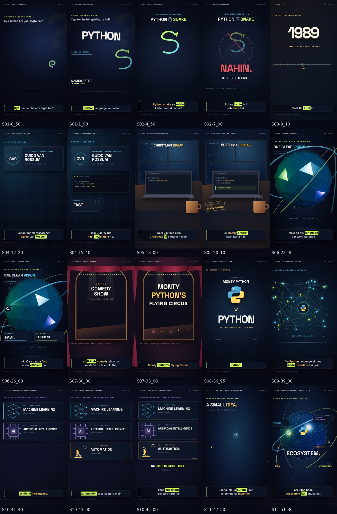

# Scene-by-Scene Storyboard

**Format:** 1080×1920 · 30 fps · 11 scenes · 52.21875 seconds

The original Hindi/Hinglish voice is the timing master. All visuals are original programmatic SVG, CSS and Three.js graphics; no unrelated stock footage is used.

## S01 · 00.00–03.05 · The Assumption

**Narration:** kya tumhe bhi yahi lagta hai? Python language ka नाम…

**Visual concept:** A confrontational kinetic-type cold open: PYTHON assembles letter by letter while a coiled line-art serpent and a huge question mark establish the assumption.

**Background:** Midnight indigo editorial grid, radial spotlight, fine film grain and restrained chartreuse accents.

**Animated objects:** Custom SVG serpent, sliced typographic masks, question-mark orbit and scanning rule.

**Typography:** Space Grotesk 800 with faux-3D extrusion; Inter for Roman Hinglish spoken captions.

**Camera:** Fast 4% push-in; slight perspective settling after the title lands.

**Transition:** A chartreuse scan bar wipes into the snake hypothesis.

**Sound:** 0.08 s soft impact; 1.66 s title slam; 2.88 s whoosh.

## S02 · 03.05–08.26 · Myth, Corrected

**Narration:** Python snake se relate karte hue rakha hai? But ye kahin bhi sahi nahi hai.

**Visual concept:** The serpent is visually connected to Python, then the connection breaks and a decisive NOT THE SNAKE correction replaces it.

**Background:** Deep navy with a drafting-board circle and restrained red correction marks.

**Animated objects:** Animated SVG snake path, broken connector, circular strike and editorial labels.

**Typography:** Condensed uppercase statement with mask reveal; oversized NAHIN as the emotional beat.

**Camera:** Lateral drift followed by a rapid 6% punch on ‘NAHIN’.

**Transition:** The strike circle becomes the rim of the 1989 timeline.

**Sound:** 4.30 s subtle digital ticks; 6.48 s low impact; 8.10 s morph whoosh.

## S03 · 08.26–10.50 · 1989

**Narration:** baat thi 1989 ki.

**Visual concept:** A monumental date emerges from a moving archival timeline; no unrelated historical imagery.

**Background:** Warm charcoal paper texture meeting cool midnight blue, with a fine horizontal time ruler.

**Animated objects:** 1989 extruded numerals, year ticks, a single glowing origin node and archival registration marks.

**Typography:** Tabular Space Grotesk numerals, very large and tightly tracked.

**Camera:** Timeline trucks left while the camera pushes toward the selected year.

**Transition:** The origin node expands into Guido’s research blueprint.

**Sound:** 8.28 s year impact; 9.36 s soft clock tick; 10.34 s whoosh.

## S04 · 10.50–16.45 · The Designer’s Brief

**Narration:** jahan par ek researcher Guido van Rossum ek aisi language chahta tha joki C se zyada fast ho, simple ho.

**Visual concept:** A custom researcher identity card and code blueprint introduce Guido; FAST and SIMPLE become the two design requirements.

**Background:** Cyan-on-navy technical drafting surface with depth-separated grid planes.

**Animated objects:** GVR monogram, animated terminal lines, C block, two requirement cards and connecting paths.

**Typography:** Editorial nameplate plus monospaced code and bold requirement labels.

**Camera:** 2.5D parallax push through foreground grid, identity card and rear code plane.

**Transition:** Terminal window folds into the laptop on the Christmas desk.

**Sound:** 11.05 s UI confirm; 14.86 s fast tick; 15.48 s simple chime.

## S05 · 16.45–21.20 · A Christmas Side Project

**Narration:** wahi usi time apni Christmas ki chuttiyon mein ek hobby project start karta hai.

**Visual concept:** A cinematic 2.5D winter workspace: snow beyond the window, warm practical lights and a laptop where a side project runs for the first time.

**Background:** Cool blue night exterior contrasted with an amber interior, soft shadows and layered depth of field.

**Animated objects:** Snow layers, window mullions, desk, coffee steam, fairy lights, laptop code and HOBBY PROJECT stamp.

**Typography:** Small warm editorial labels; PROJECT START appears as a terminal confirmation.

**Camera:** Slow lateral dolly and push-in; snow and desk move at different depths.

**Transition:** Laptop screen zooms into the abstract 3D language core.

**Sound:** 16.60 s soft winter bell; 19.94 s project-start impact; 21.02 s screen whoosh.

## S06 · 21.20–27.50 · The Language Core

**Narration:** jismein wo decide karta hai, main ek aisi language par work karunga joki C se zyada fast ho aur efficient ho.

**Visual concept:** An original Three.js metallic code core assembles from wireframe to solid while FAST and EFFICIENT lock into orbit.

**Background:** Dark technical void with volumetric-looking cones, sparse stars and a reflective floor grid.

**Animated objects:** Real-time Three.js icosahedron, chrome torus rings, point particles, orbiting C badge and typographic gauges.

**Typography:** Huge mask-revealed FAST and EFFICIENT; minimal monospaced annotations.

**Camera:** Deterministic 3D dolly from 9 to 6.8 units with gentle orbital rotation.

**Transition:** A chrome ring expands into a circular theatre spotlight.

**Sound:** 21.62 s decision click; 24.22 s core ignition; 25.84 s fast accent; 26.64 s efficient accent.

## S07 · 27.50–34.05 · The Real Namesake

**Narration:** aur usne is language ka naam rakha ek British comedy show se relate karte hue, joki tha Monty Python’s Flying Circus.

**Visual concept:** The technical world gives way to a custom retro theatre: curtains open, marquee bulbs illuminate and the comedy-show title takes the stage.

**Background:** Burgundy velvet, brass trim, dark stage floor and two warm spotlight cones.

**Animated objects:** Curtains, animated marquee, vintage title card, playful geometric circus orbit and subtle Union-Jack-inspired corner stripes.

**Typography:** Vintage serif-like stage lettering paired with clean Space Grotesk title blocks.

**Camera:** Proscenium dolly-in with a gentle handheld-free float; title cards arrive word by word.

**Transition:** Marquee bulbs fly forward and resolve into the Python name reveal.

**Sound:** 27.62 s curtain whoosh; 29.66 s marquee click; 32.28 s three soft show-title hits.

## S08 · 34.05–37.45 · Python Gets Its Name

**Narration:** isi ke naam par usne apni language ka naam rakha — Python.

**Visual concept:** A direct visual match: MONTY PYTHON collapses to a single glowing PYTHON nameplate and original two-colour Python-inspired mark.

**Background:** Clean midnight stage with ivory title card, blue/yellow brand accents and restrained spotlight.

**Animated objects:** Connecting name line, custom interlocking Python mark, extruded title and small naming seal.

**Typography:** PYTHON in massive 3D-shadowed capitals; Monty Python source line remains secondary.

**Camera:** Quick push on ‘Python’, then a controlled half-second hold.

**Transition:** The nameplate’s central node detonates into the invention network.

**Sound:** 34.16 s connection tone; 36.86 s naming impact; 37.32 s ignition whoosh.

## S09 · 37.45–40.20 · An Invention Expands

**Narration:** ye Python language ek itna bada invention hai, जोकि…

**Visual concept:** One small origin node branches into an increasingly dense connected system, making ‘how big an invention’ visible rather than literal.

**Background:** Deep blue network space with architectural grid and depth-faded nodes.

**Animated objects:** Animated SVG connections, moving pulses, expanding rings and an INVENTION central label.

**Typography:** INVENTION appears inside a technical focus frame; scale words stay sparse.

**Camera:** Pull-back reveals the network’s scale as new branches appear.

**Transition:** Three primary branches become the ML, AI and automation panels.

**Sound:** 37.48 s low ignition; 38.90 s expansion impact; 40.02 s tri-panel whoosh.

## S10 · 40.20–46.35 · Three Fields, One Language

**Narration:** machine learning, artificial intelligence, automation jaise sectors mein kaafi important role play karti hai.

**Visual concept:** Three synchronized custom infographics: a neural graph for ML, a living processor for AI and an articulated robotic arm for automation.

**Background:** Three premium glass/metal instrument panels over a shared dark grid; cyan, violet and amber distinguish the fields.

**Animated objects:** Neural nodes, chip traces, robotic joints, gear teeth, data rails and sequential status lines.

**Typography:** Large numbered domain names; IMPORTANT ROLE resolves as the shared conclusion.

**Camera:** Virtual camera pans across the triptych, then lifts to show all three working together.

**Transition:** Panels collapse to one small origin cube, matching the final reflection.

**Sound:** 40.18 s ML ping; 40.94 s AI ping; 42.49 s automation servo; 44.50 s shared impact.

## S11 · 46.35–52.23 · From Side Project to Ecosystem

**Narration:** socho, ek us purane time ka chhota sa invention, jiski wajah se aaj kitna bada ecosystem ban chuka hai.

**Visual concept:** The tiny origin cube returns, then grows into a luminous Three.js ecosystem globe surrounded by the three fields and a 1989-to-today arc.

**Background:** Cinematic midnight-to-dawn gradient with a fine orbital horizon and atmospheric particles.

**Animated objects:** Three.js network sphere, orbiting rings and points; domain satellites, 1989 origin marker and final Python mark.

**Typography:** Small idea, big ecosystem: SMALL IDEA scales into ECOSYSTEM; final 1989 → TODAY lockup.

**Camera:** Measured 3D pull-back, final two-degree rise and stable end hold.

**Transition:** Clean final hold; music and visual motion resolve with the last spoken word.

**Sound:** 46.38 s reflective tone; 49.00 s growth whoosh; 50.96 s final warm impact; 52.08 s soft resolve.
